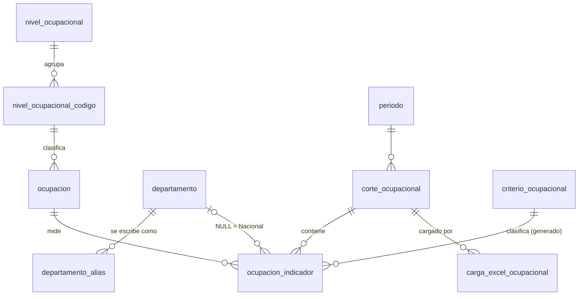

# Análisis de normalización · Percentiles ocupacionales (OLO)

Documento de especificación para el agente de programación. Describe el Excel de origen, los hallazgos de coherencia, el modelo relacional normalizado, el mapeo Excel → BD, el proceso de carga y el contrato del buscador.

Archivos que acompañan este documento, ambos probados contra PostgreSQL 16 cargando el archivo real completo:

| Archivo | Contenido |
|---|---|
| `001_percentiles_ocupacionales.sql` | DDL completo, índices, semillas de tablas maestras y vista `v_buscador_ocupacional`. Idempotente. |
| `002_carga_y_validaciones.sql` | SQL del proceso de carga: staging, validaciones V1–V9, persistencia atómica, consulta de referencia del buscador, opciones de los filtros y consultas del panel de actualización (matriz de estado y publicación masiva). Placeholders `$1..$n` (node-postgres). |

---

## 1. Anatomía del Excel de origen

El libro tiene dos hojas sin celdas combinadas y con encabezado en la fila 1.

| Hoja | Filas de datos | Columnas | Grano |
|---|---|---|---|
| `percentiles nacional` | 611 | 12 (A–L) | una fila por ocupación |
| `percentiles departamental` | 20.163 | 13 (A–M) | una fila por departamento × ocupación (33 × 611, matriz completa) |

Columnas de la hoja nacional: `N.C.`, `Descripción Nivel de Cualificación`, `Código ocupación`, `Descripción`, `Inscritos`, `Vacantes`, `Percentil Inscritos`, `Percentil Vacantes` y las cuatro columnas de criterio. La hoja departamental agrega `Departamento` en la columna C, llama `Ocupación` a lo que la nacional llama `Descripción` y escribe `Percentil vacantes` con minúscula.

Las columnas de percentil son valores escritos (no fórmulas). Las cuatro columnas de criterio sí son fórmulas en todas las filas, y en la hoja departamental están correctamente desplazadas a H/I:

```
Nacional (G = Percentil Inscritos, H = Percentil Vacantes)
I: =IF(AND(G2>80%,H2>80%),"X","")
J: =IF(AND(G2>80%,H2<=80%),"X","")
K: =IF(AND(H2>80%,G2<=80%),"X","")
L: =IF(AND(G2<=80%,H2<=80%),"X","")
```

El Excel **no** contiene año ni periodo. Esos dos filtros del buscador tienen que venir del formulario de carga.

---

## 2. Hallazgos de coherencia (todos verificados sobre el 100 % de las filas)

**La tabla maestra de Nivel Ocupacional sí está en los datos, y es la clave del cálculo.** La columna `N.C.` trae los dígitos 0, 1, 2, 3, 4 y 6, y su descripción corresponde exactamente con la maestra: 0 → Dirección y Gerencia, 1 → A, 2 → B, 3 y 4 → C (ambos dicen "Nivel C (Oficios Calificados)"), 6 → D. Más importante aún: los percentiles se calcularon particionando por esos **cinco** niveles (0, A, B, C, D), es decir, uniendo el 3 y el 4 en C. Si se particiona por el dígito N.C. el cálculo solo coincide en el 54–60 % de las filas; por nivel 0/A/B/C/D coincide en el 100 %. La maestra no es decorativa: es el grupo de comparación de la metodología.

**El N.C. se deriva del código de ocupación.** En los 611 códigos: si el primer dígito es `0`, N.C. = 0; si no, N.C. = segundo dígito del código. Ejemplos: `0111` → 0, `2241` → 2, `8411` → 4. Por eso en el modelo el N.C. es una columna generada a partir del código.

**Metodología de percentiles reproducida al 100 %.** Dentro de cada ámbito (nacional o un departamento) y cada nivel ocupacional, se toman solo las ocupaciones con valor ≥ 10; se ordenan ascendentemente por el valor y, en empate, por código ascendente; el percentil es posición ÷ total del grupo. Con valor < 10 la celda queda vacía (201 vacíos en inscritos y 170 en vacantes a nivel nacional; 18.025 y 17.718 en departamental). La validación V6 del archivo 002 implementa exactamente esta regla y sobre el archivo real devuelve 0 diferencias.

**Las fórmulas de criterio son coherentes en todas las filas.** Cada una de las 20.774 filas tiene exactamente una "X", y la "X" coincide con la fórmula en el 100 % de los casos. Una celda de percentil vacía Excel la evalúa como 0, por lo que cae en "menos solicitadas"; el modelo replica eso con `COALESCE(percentil, 0)`. Hay 51 filas con percentil exactamente igual a 0,8, así que la comparación estricta `> 0.8` importa y debe hacerse en `double precision` como Excel.

**Nacional = suma exacta de los departamentos.** Para las 611 ocupaciones, inscritos y vacantes nacionales son la suma de los 33 departamentos (totales: 334.608 inscritos y 278.089 vacantes).

**Las celdas vacías de inscritos/vacantes en la hoja departamental significan 0.** La hoja departamental no tiene ni un solo cero explícito (13.264 vacíos en inscritos, 13.675 en vacantes) y las sumas cuadran con la nacional tratando vacío = 0.

**Descripciones consistentes entre hojas.** Cada código tiene el mismo nombre en ambas hojas; no hay espacios sobrantes ni duplicados de grano.

**Problemas de calidad a manejar en el cargador:**

| Problema | Tratamiento |
|---|---|
| Errores tipográficos: "Técnologos" y "Oficios Oficios Elementales" | No se guarda la columna de descripción del nivel; el nombre sale del catálogo. |
| Código con ceros a la izquierda (`0011`). En este archivo está como texto, pero cualquier lector que lo convierta a número lo rompe (`11`) | Leer como texto; si llega numérico, `padStart(4, '0')`. |
| Encabezados con dobles espacios, espacios finales y mayúsculas distintas entre hojas | Mapear por encabezado normalizado, nunca por posición. |
| Nombres de departamento no oficiales: "Guajira, La", "San Andrés y Providencia", "Bogotá D.C." | Resolver con la tabla `departamento_alias` sobre el nombre normalizado. |

**Alertas metodológicas para negocio (no son errores de BD, pero afectan el buscador):**

Hay 9 grupos donde dos ocupaciones con el mismo número de registros, en el mismo departamento y nivel, quedan en criterios distintos solo por el desempate por código (1 en inscritos, 8 en vacantes). Ejemplo: en San Andrés, nivel D, las ocupaciones `6621` y `8612` tienen 11 inscritos cada una y reciben percentil 0,5 y 1,0 respectivamente, así que solo la segunda aparece como "más registrada".

Hay 13 combinaciones departamento × nivel con una sola ocupación de 10 o más inscritos; esa ocupación recibe percentil 1,0 automáticamente y queda clasificada como "más registrada" aunque el volumen sea pequeño.

El 56 % de las filas departamentales (11.303 de 20.163) tienen 0 inscritos y 0 vacantes y caen en "menos solicitadas". Se almacenan igual (fidelidad con el Excel), pero la vista expone `sin_registros` para que el front pueda ocultarlas.

---

## 3. Análisis de dependencias y formas normales

Dependencias funcionales identificadas:

```
codigo_ocupacion              → nombre_ocupacion, codigo_nc
codigo_ocupacion              → codigo_nc            (derivable: regla del dígito)
codigo_nc                     → nivel_ocupacional     (0,1,2,3,4,6 → 0,A,B,C,C,D)
nivel_ocupacional             → nombre, descripción
nombre_departamento           → código DANE
(corte, ámbito, ocupación)    → inscritos, vacantes, percentil_inscritos, percentil_vacantes
(percentil_ins, percentil_vac) → criterio             (fórmula del 80 %)
nacional(ocupación)           = Σ departamental(ocupación)
```

Violaciones que presenta el Excel tal cual:

La primera forma normal se rompe con las cuatro columnas "X": son un grupo repetido que codifica un solo atributo categórico (el criterio). Se colapsan en una única columna `criterio_id`. La segunda forma normal se rompe porque en la hoja departamental la clave es (departamento, código) y el nombre de la ocupación y su nivel dependen solo del código; van a la tabla `ocupacion`. La tercera forma normal se rompe porque la descripción del nivel depende del N.C., que a su vez depende del código; va a `nivel_ocupacional` vía `nivel_ocupacional_codigo`. Además, el criterio es un dato derivado de los percentiles y se calcula en la BD con la misma fórmula del Excel.

---

## 4. Modelo propuesto



### Tablas maestras (semillas, no cambian con la carga)

| Tabla | Filas | Propósito |
|---|---|---|
| `nivel_ocupacional` | 5 | 0, A, B, C, D con `etiqueta` (texto exacto del filtro), nombre y descripción. Filtro "Nivel Ocupacional". |
| `nivel_ocupacional_codigo` | 6 | Traduce el dígito N.C. del Excel (0,1,2,3,4,6) a nivel. |
| `criterio_ocupacional` | 4 | Los cuatro criterios del buscador, con la regla documentada. |
| `departamento` | 33 | Código DIVIPOLA como PK. Filtro "Departamento". |
| `departamento_alias` | 40 | Nombres alternativos normalizados → departamento. |
| `periodo` | 7 | Catálogo cerrado: cuatro trimestres, dos semestres y anual. Filtro "Periodo". |

### Maestra alimentada por el Excel

`ocupacion` (611 filas con este archivo): `codigo CHAR(4)` único con `CHECK` de cuatro dígitos, `nombre`, y `codigo_nc` como columna **generada** a partir del código con FK a `nivel_ocupacional_codigo`. Si un código futuro produce un dígito N.C. no catalogado (por ejemplo 5), la FK lo rechaza. Se actualiza por upsert en cada carga, pero el nombre solo lo cambia un corte igual o más reciente que el que lo fijó (`nombre_vigencia` = año × 10 + orden del periodo), de modo que el orden en que se carguen los archivos históricos no altera el resultado.

### Tablas de carga

`corte_ocupacional`: una fila por (año, periodo), con `UNIQUE (anio, periodo_id)`, año entre 2012 y 2100, y `estado` `borrador | publicado`. Guarda `huella_datos` (md5 del contenido numérico del archivo) con restricción `UNIQUE`, lo que impide que el mismo archivo quede cargado en dos celdas distintas. El buscador público solo lee cortes publicados, en línea con el flujo editorial de OLO.

`carga_excel_ocupacional`: bitácora de cada intento de carga (archivo, SHA-256, usuario, estado `procesando | completada | fallida`, conteos y `reporte JSONB` con errores y advertencias). La columna `usuario_id` debe ajustarse al tipo y FK de la tabla de usuarios existente.

### Tabla de hechos

`ocupacion_indicador`, grano corte × ámbito × ocupación. `departamento_id NULL` representa la hoja nacional. Guarda `inscritos` y `vacantes` (`NOT NULL DEFAULT 0`), `percentil_inscritos` y `percentil_vacantes` (`DOUBLE PRECISION`, NULL = celda vacía) y `criterio_id` como **columna generada STORED** con la fórmula del Excel y FK a `criterio_ocupacional`:

```sql
CASE
  WHEN COALESCE(percentil_inscritos,0) > 0.8 AND COALESCE(percentil_vacantes,0) > 0.8 THEN 1
  WHEN COALESCE(percentil_inscritos,0) > 0.8 THEN 2
  WHEN COALESCE(percentil_vacantes,0)  > 0.8 THEN 3
  ELSE 4
END
```

La unicidad del grano se impone con dos índices únicos parciales (uno para nacional y otro para departamental), que funcionan en cualquier versión de PostgreSQL. El índice `(corte_id, departamento_id, criterio_id)` sirve la consulta principal del buscador.

### Vista del buscador

`v_buscador_ocupacional` une hechos, corte, periodo, ocupación, nivel, criterio y departamento (con `'Nacional'` cuando es NULL) y expone `es_nacional` y `sin_registros`. Es lo único que debe consultar el repositorio del buscador.

### Vista del panel de actualización

`v_estado_cargas_ocupacional` genera la matriz año × periodo desde 2012 hasta el año actual (hoy 15 × 7 = 105 celdas; crece sola cada enero) y devuelve por celda el corte, su estado, el último intento de carga y `estado_celda`: `pendiente`, `procesando`, `borrador`, `publicado` o `fallido`.

---

## 5. Decisiones de diseño y su justificación

**Criterio calculado, no almacenado desde el Excel.** Es lo que pide el negocio (el criterio se mide por la fórmula) y elimina la posibilidad de que una "X" editada a mano contradiga los percentiles. Al ser columna generada STORED se puede indexar y filtrar sin costo. El umbral 0,8 queda en el DDL; si SENA cambia la metodología, se cambia con una migración que recalcula todo de forma explícita.

**Percentiles almacenados tal como los publica el Excel, con recálculo de control.** Formalmente son derivables (la metodología se reprodujo al 100 %), pero dependen de una decisión metodológica del equipo de análisis y del desempate por código, que es frágil. Se guarda lo publicado para garantizar que el buscador muestre exactamente la cifra oficial, y la validación V6 recalcula con la regla detectada y reporta diferencias como advertencia. Si algún día el Excel llega sin percentiles, la misma consulta de V6 sirve para calcularlos en la BD.

**Nacional almacenado como filas propias y validado como suma.** Inscritos y vacantes nacionales son derivables, pero los percentiles nacionales no se obtienen sumando, así que la fila nacional tiene que existir. La coherencia se garantiza con V5, que es error bloqueante. Esta desnormalización controlada es aceptable porque los datos de un corte son una foto inmutable que se reemplaza completa y en una transacción: no existen las anomalías de actualización que la normalización busca evitar.

**`DOUBLE PRECISION` para percentiles.** Replica la aritmética de Excel en la frontera del 80 %. Hay 51 filas exactamente en 0,8 y todas se clasifican igual que en el Excel.

**Matriz completa almacenada**, incluidas las filas 0/0, porque el Excel las clasifica y el criterio "menos solicitadas" las incluye. El front decide si mostrarlas usando `sin_registros`.

**Año y periodo como corte.** El Excel no los trae; el administrador los elige al cargar. El corte agrupa todos los hechos y permite reemplazo atómico y publicación.

---

## 6. Mapeo Excel → BD

Normalización de encabezados y nombres de hoja: quitar tildes, pasar a minúsculas, reemplazar todo lo que no sea letra o dígito por espacio y colapsar espacios. Mapa resultante:

```ts
export const SHEETS = {
  'percentiles nacional': 'NAC',
  'percentiles departamental': 'DEP',
} as const;

export const HEADERS: Record<string, string> = {
  'n c': 'codigoNc',
  'descripcion nivel de cualificacion': 'nivelDescripcion', // se lee pero NO se guarda
  'departamento': 'departamento',
  'codigo ocupacion': 'codigo',
  'descripcion': 'nombre',      // hoja nacional
  'ocupacion': 'nombre',        // hoja departamental
  'inscritos': 'inscritos',
  'vacantes': 'vacantes',
  'percentil inscritos': 'pctInscritos',
  'percentil vacantes': 'pctVacantes',
  'ocupaciones mas solicitadas por los empresarios y personas que buscan empleo': 'x1',
  'ocupaciones mas registradas por las personas que buscan empleo y menos solicitadas por los empresarios': 'x2',
  'ocupaciones mas solicitadas por los empresarios y menos registradas por las personas que buscan empleo': 'x3',
  'ocupaciones menos solicitadas por los empresarios y personas que buscan empleo': 'x4',
};
```

| Columna Excel | Destino | Transformación |
|---|---|---|
| `N.C.` | `stg.codigo_nc_excel` | Entero. Solo para validar contra el derivado (V2). |
| `Descripción Nivel de Cualificación` | — | Se descarta (redundante y con errores tipográficos). |
| `Departamento` | `ocupacion_indicador.departamento_id` | Normalizar y resolver en `departamento_alias`. Hoja nacional → NULL. |
| `Código ocupación` | `ocupacion.codigo` | Texto; si es numérico, `String(v).padStart(4,'0')`. Debe cumplir `^[0-9]{4}$`. |
| `Descripción` / `Ocupación` | `ocupacion.nombre` | `trim`. Upsert en el catálogo. |
| `Inscritos`, `Vacantes` | columnas homónimas | Vacío → 0. Entero ≥ 0. |
| `Percentil Inscritos`, `Percentil Vacantes` | `percentil_*` | Vacío → NULL. Número en (0, 1]. |
| Cuatro columnas "X" | `stg.criterio_excel` | Posición de la única "X" (1–4) o NULL. Solo para la advertencia V7; **nunca** se persiste. |

Un detalle importante: las columnas "X" son fórmulas y su valor solo existe si el archivo lo guardó Excel (valor en caché). Un archivo generado o re-guardado por otra herramienta puede traerlas vacías. El cargador no debe depender de ellas; por eso V7 solo se evalúa cuando hay valor.

---

## 7. Proceso de carga

El proceso encaja en la arquitectura existente del backend (controller → use-case → repository) y en el flujo de carga de Excel del panel de administración. Debe exigir un permiso RBAC propio para cargar y otro para publicar.

**Petición.** `POST /api/admin/ocupacional/cargas` con `multipart/form-data`: `archivo` (.xlsx), `anio`, `periodoId` y `reemplazar` (booleano, por defecto `false`). Un archivo por petición; la carga masiva de la sección 8 llama este mismo endpoint una vez por archivo. La API valida `2012 ≤ anio ≤ año actual`. Se reutiliza la validación de tipo y tamaño de archivo que ya existe en el proyecto.

**Bitácora fuera de la transacción.** Antes de abrir la transacción se inserta la fila en `carga_excel_ocupacional` con estado `procesando` y el SHA-256 del archivo, para que el registro sobreviva a un rollback. Al terminar se marca `completada` (dentro de la transacción, paso 3.4) o `fallida` con el reporte (fuera, tras el rollback).

**Lectura del libro.** Con `exceljs` en el backend, leyendo valores (no fórmulas). Ubicar las hojas por nombre normalizado, construir el índice de columnas por encabezado normalizado y fallar con un mensaje claro si falta alguna columna obligatoria. Saltar filas completamente vacías. Guardar el número de fila del Excel en cada registro para que los errores sean accionables.

**Validación por fila en TypeScript (zod o equivalente).** Tipos y rangos, código de cuatro dígitos, N.C. entero, departamento resuelto, inscritos/vacantes enteros no negativos, percentiles en (0, 1]. Los errores se acumulan (no se corta en el primero), con un tope razonable para el reporte.

**Transacción.** Ejecutar en orden los bloques del archivo `002_carga_y_validaciones.sql`: candado por corte con `pg_advisory_xact_lock`; creación de la tabla temporal `stg_ocupacional`; inserción por lotes de ~1.000 filas; validaciones V1–V5 (cualquier fila devuelta aborta con rollback) y V6–V9 (se agregan al reporte como advertencias); cálculo de la huella (bloque H) y validación V10, que aborta si ese mismo contenido ya está cargado en otra celda; upsert de ocupaciones con la regla de vigencia del nombre; creación u obtención del corte (si ya está `publicado` y `reemplazar` es falso, rollback y respuesta 409); borrado de los hechos del corte e inserción desde staging; cierre de la bitácora; commit. El reemplazo ocurre dentro de la misma transacción, así que el sitio público nunca ve un corte a medio cargar.

**Respuesta.** `201` con `{ cargaId, corteId, estadoCorte, filasNacional, filasDepartamental, advertencias }`; `422` con la lista de errores si falló la validación; `409` si el corte está publicado y no se pidió reemplazo.

**Publicación.** `POST /api/admin/ocupacional/cortes/publicar` con `{ corteIds: number[] }` publica uno o varios cortes en borrador y registra `publicado_en`; `PATCH /api/admin/ocupacional/cortes/:id/despublicar` los devuelve a borrador. Si el sitio usa revalidación bajo demanda, este es el momento de dispararla.

---

## 8. Carga histórica desde Panel General › Actualización

### Alcance

El equipo de análisis genera un archivo por cada combinación de año y periodo: cuatro trimestres, dos semestres y un anual. Para la serie 2012–2026 son 7 × 15 = 105 archivos, y a partir de ahí se suman siete por año. Cada archivo es un corte independiente, con sus propios inscritos, vacantes y percentiles. La BD no asume que un semestre sea la suma de sus trimestres ni que el anual sea la suma de los semestres: los percentiles se calculan sobre cada periodo por separado.

La funcionalidad vive en el panel general del sitio, sección **Actualización**, con acceso restringido por permiso RBAC (cargar y publicar son permisos distintos).

### Pantalla: matriz de estado

La vista principal es una matriz con los años en filas (2026 arriba, 2012 abajo) y los siete periodos en columnas, alimentada por `GET /api/admin/ocupacional/estado` (consulta "Matriz de estado" del archivo 002). Cada celda muestra su `estado_celda` con un color y un ícono (no solo color, por accesibilidad):

| `estado_celda` | Significado | Acciones de la celda |
|---|---|---|
| `pendiente` | Nunca se cargó | Cargar archivo |
| `procesando` | Carga en curso | Ninguna (esperar) |
| `borrador` | Cargado, no visible al público | Ver reporte, reemplazar, publicar |
| `publicado` | Visible en el buscador | Ver reporte, reemplazar (con confirmación), despublicar |
| `fallido` | Último intento falló y no hay datos | Ver errores, reintentar |

Si una celda tiene datos pero su último intento de reemplazo falló, conserva su estado y muestra un aviso con el reporte del intento fallido (`carga_estado = 'fallida'`). Encima de la matriz van los contadores por estado y los botones "Carga masiva" y "Publicar seleccionados" (con atajos para publicar todo un año o todos los borradores).

### Carga masiva

Cargar 105 archivos celda por celda no es práctico, así que la pantalla permite seleccionar muchos archivos a la vez con este flujo:

**1. Selección.** El administrador arrastra o elige varios `.xlsx`.

**2. Propuesta de celda por nombre de archivo.** El front propone año y periodo a partir del nombre. La convención recomendada para que el equipo de análisis nombre los archivos es `percentiles_AAAA_PERIODO.xlsx`, con PERIODO en `T1`, `T2`, `T3`, `T4`, `S1`, `S2` o `ANUAL`, pero el detector también reconoce las formas en que suelen nombrarse a mano ("1er trimestre 2019", "II semestre 2016", "anual 2013"):

```ts
// Probado con: percentiles_2025_T1, "1er trimestre 2019", "2do trimestre 2014",
// percentiles-2012-3T, "Cuarto Trimestre 2020", "II semestre 2016",
// "Primer semestre 2021", "anual 2013", "trimestre 4 - 2015" → todos correctos.
// "data2.xlsx" y "..._T5" → null (el admin elige la celda a mano).
const ORD: Record<string, number> = {
  '1': 1, '1er': 1, '1ro': 1, 'i': 1, 'primer': 1, 'primero': 1,
  '2': 2, '2do': 2, 'ii': 2, 'segundo': 2,
  '3': 3, '3er': 3, '3ro': 3, 'iii': 3, 'tercer': 3, 'tercero': 3,
  '4': 4, '4to': 4, 'iv': 4, 'cuarto': 4,
};
const N = '(1er|1ro|2do|3er|3ro|4to|primero?|segundo|tercero?|cuarto|iii|ii|iv|i|[1-4])';

export function detectarCelda(nombreArchivo: string):
  { anio: number; periodoCodigo: string } | null {
  const t = nombreArchivo.replace(/\.xlsx?$/i, '')
    .normalize('NFD').replace(/[\u0300-\u036f]/g, '')
    .toLowerCase().replace(/[^a-z0-9]+/g, ' ').trim();
  const anio = t.match(/\b(20\d{2})\b/)?.[1];
  let periodo: string | null = null;
  if (/\banual\b|\banio completo\b/.test(t)) periodo = 'ANUAL';
  const tri = t.match(new RegExp(`\\b${N} ?(t|trim|trimestre)\\b`))
           ?? t.match(new RegExp(`\\b(t|trim|trimestre) ?${N}\\b`));
  const sem = t.match(new RegExp(`\\b${N} ?(s|sem|semestre)\\b`))
           ?? t.match(new RegExp(`\\b(s|sem|semestre) ?${N}\\b`));
  const num = (m: RegExpMatchArray) => ORD[m.slice(1).find(g => g && ORD[g] !== undefined)!];
  if (!periodo && tri) { const n = num(tri); if (n >= 1 && n <= 4) periodo = `T${n}`; }
  if (!periodo && sem) { const n = num(sem); if (n === 1 || n === 2) periodo = `S${n}`; }
  return anio && periodo ? { anio: Number(anio), periodoCodigo: periodo } : null;
}
```

**3. Tabla de revisión.** Antes de subir nada se muestra una fila por archivo con el año y el periodo propuestos (editables con los mismos desplegables del buscador) y un aviso en cada caso que lo requiera: no se reconoció el nombre, dos archivos apuntan a la misma celda, la celda ya tiene datos (se exige marcar "reemplazar" en esa fila) o el año está fuera de 2012–año actual. El botón "Iniciar carga" solo se habilita cuando todas las filas tienen celda válida y única.

**4. Envío secuencial.** El front envía los archivos **uno por uno** al endpoint de carga individual, con barra de progreso y el resultado de cada archivo a medida que termina. Cada archivo es su propia transacción: si uno falla, los demás siguen, y al final se muestra un resumen de cargados, con advertencias y fallidos, con acceso al reporte de cada uno.

Se prefiere el envío secuencial desde el front a una cola en el servidor porque cada archivo tarda unos 3 segundos (105 archivos ≈ 5 minutos), cada petición queda lejos de cualquier timeout de Nginx y no hace falta infraestructura nueva. Si en el futuro los archivos crecen mucho, el mismo caso de uso puede pasar a una cola con BullMQ sobre el Redis que ya existe, sin tocar la BD.

**5. Publicación.** Las celdas cargadas quedan en `borrador`. El administrador revisa y publica en bloque desde la matriz.

### Protección contra archivos equivocados

Con tantos archivos casi idénticos en estructura, el error más probable es subir el archivo de una celda en otra. V10 lo detecta: la huella del contenido numérico se compara con la de todos los cortes y, si ya existe en otra celda, la carga se rechaza indicando dónde está ese contenido. La restricción `UNIQUE (huella_datos)` lo garantiza también a nivel de BD. Reemplazar una celda con el mismo archivo que ya tenía sí está permitido.

### Nombres de ocupación a lo largo de 15 años

Si el nombre de una ocupación cambia entre años, el catálogo conserva el del corte más reciente, sin importar el orden de carga, y V8 lo reporta como advertencia. Los cortes antiguos se muestran con el nombre vigente. Esto es correcto si todos los archivos usan la misma versión de la clasificación de ocupaciones. Si los archivos de años anteriores usan una versión distinta, donde un mismo código signifique otra ocupación, un catálogo único no sirve y habría que versionar la clasificación. Por eso, antes de la carga masiva, conviene cargar un archivo de 2012 y revisar las advertencias V2 y V8.

### Volumen y rendimiento (medido)

Se simuló la serie completa de 105 cortes en PostgreSQL 16:

| Métrica | Valor |
|---|---|
| Filas en `ocupacion_indicador` | 2.181.270 |
| Tamaño tabla + índices | 346 MB (150 MB tabla, 196 MB índices) |
| Buscador por departamento + nivel + criterio | ~1,7 ms |
| Buscador nacional por criterio | ~0,5 ms |
| Serie histórica de una ocupación en un departamento (105 cortes) | ~1 ms |
| Matriz del panel | < 1 ms |
| Carga o reemplazo de un archivo con la tabla llena | ~3 s (1,3 s son lectura del Excel) |

No hace falta particionar la tabla. Cada reemplazo deja unas 20.000 tuplas muertas que el autovacuum limpia; después de una carga masiva conviene ejecutar `VACUUM ANALYZE ocupacion_indicador` (puede hacerlo el mismo caso de uso al terminar el lote o una tarea programada).

### Endpoints del panel

| Método y ruta | Uso |
|---|---|
| `GET /api/admin/ocupacional/estado` | Matriz año × periodo |
| `POST /api/admin/ocupacional/cargas` | Cargar un archivo en una celda (sección 7) |
| `GET /api/admin/ocupacional/cargas/:id` | Reporte de una carga (errores y advertencias) |
| `POST /api/admin/ocupacional/cortes/publicar` | Publicación masiva `{ corteIds }` |
| `PATCH /api/admin/ocupacional/cortes/:id/despublicar` | Volver a borrador |

---

## 9. Contrato del buscador

### Filtros de la interfaz

Los cuatro desplegables del buscador se alimentan de catálogos de la BD, no de listas fijas en el front. Los textos de las opciones salen tal cual de las columnas indicadas.

**Año.** Solo los años que tienen al menos un corte publicado, del más reciente al más antiguo.

**Periodo.** Siempre las siete opciones, en este orden:

| Opción visible | `periodo.codigo` | `periodo.id` |
|---|---|---|
| Primer trimestre | `T1` | 1 |
| Segundo trimestre | `T2` | 2 |
| Tercer trimestre | `T3` | 3 |
| Cuarto trimestre | `T4` | 4 |
| Primer semestre | `S1` | 5 |
| Segundo semestre | `S2` | 6 |
| Anual | `ANUAL` | 7 |

La consulta de opciones devuelve además `disponible` (si hay corte publicado para ese año y periodo), para que el front pueda deshabilitar o marcar los periodos sin datos.

**Nivel Ocupacional.** "Todos" lo agrega el front y significa no filtrar. El resto viene de `nivel_ocupacional.etiqueta`:

| Opción visible | `nivel_ocupacional.codigo` | Dígitos N.C. que agrupa |
|---|---|---|
| Todos | (sin filtro) | todos |
| 0 Dirección y gerencia | `0` | 0 |
| Nivel 1 (A) | `A` | 1 |
| Nivel 2 (B) | `B` | 2 |
| Nivel 3,4 (C) | `C` | 3 y 4 |
| Nivel 6 (D) | `D` | 6 |

**Departamento.** Primera opción "Nacional", que consulta las filas de la hoja nacional (`departamento_id IS NULL`); después los 33 departamentos por nombre. En "Nacional", inscritos y vacantes son la suma de los departamentos, pero los percentiles y el criterio se calculan sobre el total del país, así que una ocupación puede estar en un criterio a nivel nacional y en otro dentro de un departamento.

### Endpoints

`GET /api/ocupacional/buscador`

| Parámetro | Obligatorio | Valor | Filtro SQL |
|---|---|---|---|
| `anio` | sí | entero | `anio = …` |
| `periodo` | sí | `T1`, `T2`, `T3`, `T4`, `S1`, `S2`, `ANUAL` | `periodo_codigo = …` |
| `departamento` | sí | `nacional` o `codigo_dane` (`05`, `11`…) | `departamento_id IS NULL` o `codigo_dane = …` |
| `nivel` | no (omitido = Todos) | `0`, `A`, `B`, `C`, `D` | `nivel_codigo = …` |
| `criterio` | no | 1–4 o `criterio_ocupacional.codigo` | `criterio_id = …` |
| `q` | no | texto | `ocupacion_nombre ILIKE` o código exacto |
| `ocultarSinRegistros` | no | booleano | `NOT sin_registros` |

La respuesta incluye `nivel_etiqueta` para mostrar el nivel de cada ocupación con el mismo texto del filtro. Siempre se filtra `corte_estado = 'publicado'` en el sitio público. El repositorio debe construir el `WHERE` dinámicamente (en vez del patrón `($n IS NULL OR …)` de la consulta de referencia) para que el planificador use los índices; con el volumen actual cualquiera de las dos formas responde en menos de un milisegundo.

`GET /api/ocupacional/buscador/opciones?anio=2025` devuelve años, periodos (con `disponible` para el año indicado), niveles con etiqueta y descripción, departamentos con "Nacional" primero y los cuatro criterios. Las consultas están al final del archivo 002.

---

## 10. Criterios de aceptación con el archivo actual

Cargar `data2.xlsx` debe producir exactamente estos resultados; sirven como pruebas de integración del cargador.

| Verificación | Esperado |
|---|---|
| Filas en `ocupacion_indicador` | 20.774 (611 nacionales + 20.163 departamentales) |
| Filas en `ocupacion` | 611 |
| Errores V1–V5 | 0 |
| Advertencias V6 (percentiles recalculados) | 0 |
| Advertencias V7 ("X" vs fórmula) | 0 |
| Suma nacional de inscritos / vacantes | 334.608 / 278.089 |
| Criterios nacionales (1, 2, 3, 4) | 54, 30, 37, 490 |
| Criterios departamentales (1, 2, 3, 4) | 165, 321, 387, 19.290 |
| Ocupaciones nacionales por nivel (0, A, B, C, D) | 51, 104, 183, 243, 30 |
| Segunda carga del mismo corte | Reemplaza sin duplicar (mismos conteos) |
| Matriz del panel con la BD vacía | 105 celdas `pendiente` (2012–2026 × 7) |
| Mismo archivo cargado como 2025 S1 y luego como 2025 T1 | El segundo falla con V10 señalando "2025 · Primer semestre" |
| Recargar un corte publicado sin `reemplazar` | 409, sin cambios |
| Nombre distinto en un archivo de 2013 cargado después de uno de 2025 | Advertencia V8; el catálogo conserva el nombre de 2025 |
| Nombre distinto en un archivo de 2026 | El catálogo toma el nombre de 2026 |

Pruebas negativas que ya se verificaron con una copia alterada del archivo: departamento "Amazonía" → V1; N.C. 1 en el código `0014` → V2; inscritos nacionales de `0012` en 894 en lugar de 893 → V5; código escrito como número `13` → se recupera como `0013`; percentil publicado alterado → advertencia V6 y el criterio se recalcula con el valor almacenado. En todos los casos de error no se crea el corte y la bitácora queda `fallida`.

---

## 11. Pendientes para negocio

Antes de la carga masiva hay que confirmar que los archivos de 2012 en adelante usan la misma versión de la clasificación de ocupaciones que el archivo actual (sección 8). También conviene acordar con el equipo de análisis la convención de nombres de archivo. Falta la descripción larga del nivel 0 (Dirección y Gerencia). Conviene confirmar si el dígito 5 de N.C. existe en la clasificación oficial, porque hoy no aparece en los datos y la BD lo rechazaría. Por último, negocio debería decidir cómo tratar los empates que cruzan el 80 % y los grupos con una sola ocupación, y si el buscador debe ocultar por defecto las ocupaciones sin registros.

Si en el proyecto ya existe una tabla de departamentos (por ejemplo, la del módulo de programas sobresalientes) o una tabla de ocupaciones CNO para el buscador de ocupaciones, el agente debe reutilizarlas en lugar de `departamento` y `ocupacion`, conservando las columnas y restricciones descritas aquí.
