# Guía del Proyecto

> Sistema integrado de control de contenidos para el sitio web del Observatorio Laboral SENA. Documento de referencia de arquitectura: qué necesita el cliente, cómo se resuelve, cómo está arquitecturado el sistema y cómo se organiza el código.
---

## 1. Necesidad del cliente

El Observatorio Laboral y Ocupacional es una entidad que gestiona **datos del mercado laboral y la empleabilidad**, información que cambia constantemente. Por eso el portal no puede ser un sitio estático mantenido por desarrolladores: necesita que **el propio equipo del OLO edite y reorganice el contenido** sin intervención técnica.

La necesidad central, en sus propias palabras traducidas a requisitos:

- El sitio parte de un **diseño base institucional** (identidad SENA, directrices MinTIC, colores, tipografía, accesibilidad).
- Sobre ese diseño base, los editores deben poder **reorganizar la maqueta, agregar nuevas secciones y reutilizar componentes** (átomos, moléculas, organismos) — siempre **respetando la identidad visual y las directrices**. No es edición libre sin reglas: es **composición controlada dentro de un sistema de diseño institucional**.
- Debe existir un **flujo de gobernanza**: los editores proponen, un administrador aprueba, y solo entonces el contenido se publica.
- El sitio público es abierto; existe además una **intranet privada** para directores y subdirectores con información estratégica.

### Requerimientos funcionales (17)

| # | Requerimiento | Norma / Nota |
|---|---|---|
| RF-01 | Crear, editar, publicar y despublicar contenidos (estudios, informes, estadísticas, banners) desde el panel, sin desarrolladores | — |
| RF-02 | Cargar y gestionar documentos (PDF, xlsx, JPG, PNG, SVG) con validación de tipo y tamaño configurable, más enlaces de video/Power BI | — |
| RF-03 | Configurar tipografías, colores institucionales y elementos de marca desde el panel | Manual de identidad SENA |
| RF-04 | Crear, configurar y asignar roles (editores, visitantes internos); Administrador con control total | RBAC |
| RF-05 | Restringir al Editor la publicación directa; visitantes solo visualizan | — |
| RF-06 | Flujo de aprobación: contenido de Editor pasa a "En revisión" hasta que el Administrador apruebe | — |
| RF-07 | Historial de cambios por contenido: usuario, campos modificados, fecha y hora | — |
| RF-08 | Insertar tableros Power BI y analítica mediante contenedores configurables desde el CMS, sin código | — |
| RF-09 | Buscador de ocupaciones basado en CNO con correlación CUOC, consultando en línea la BD del OLO | Fuente externa |
| RF-10 | Buscador interno que filtra contenidos | — |
| RF-11 | Navegación jerárquica: cualquier contenido en máximo 3 clics desde el inicio | — |
| RF-12 | Descarga directa de documentos publicados sin registro ni autenticación | — |
| RF-13 | Aviso de privacidad con aceptación explícita en formularios que recopilen datos personales | Ley 1581/2012 |
| RF-14 | Accesibilidad para discapacidad visual: lectores de pantalla y alto contraste | Resolución 1519/2020 |
| RF-15 | Espacio exclusivo para directores: visualizar y descargar información interna del OLO | — |
| RF-16 | Autenticación (usuario/contraseña) para todos los roles; fecha de caducidad para todos excepto el administrador | — |
| RF-17 | Respaldos automáticos periódicos de la BD con frecuencia configurable | — |

---

## 2. Solución implementada

Una plataforma de **tres capas** bajo un modelo **CMS headless con composición visual**:

- **Dos capas frontend** (Next.js) en puertos distintos, cada una con su propia identidad visual y su propio despliegue:
  - **Sitio web público** (`:3000`): páginas dinámicas abiertas + panel administrativo interno.
  - **Intranet** (`:3001`): 100% protegida, identidad visual propia, para directores/subdirectores.
- **Un backend API** (Express, `:4000`) que es la **única puerta de entrada a los datos**. Ningún frontend toca la base de datos, el filesystem ni Redis directamente: todo pasa por la API, que valida, autoriza y controla qué entra y sale.
- **Infraestructura**: PostgreSQL (datos), Redis (caché de páginas públicas + colas de trabajos), Nginx (reverse proxy + SSL en producción).

### Cómo la solución cubre la necesidad

| Necesidad | Cómo se resuelve |
|---|---|
| Editar sin desarrolladores | Editor visual (Puck) que compone páginas con un catálogo de bloques |
| Respetar el diseño institucional | El catálogo de bloques ES el sistema de diseño (átomos/moléculas/organismos); el editor solo puede componer con piezas que nosotros escribimos, así que la identidad SENA y la Res. 1519 se garantizan **en `shared/ui`, no en cada página**. La arquitectura lo hace posible; el estado real de la accesibilidad está auditado en `9-accesibilidad.md` §2 |
| Contenido siempre actualizado | Todo el contenido es dinámico (JSONB en Postgres), servido por la API |
| Gobernanza | Flujo `borrador → en revisión → publicado/rechazado`; solo el admin publica |
| Rendimiento con tráfico alto | Páginas públicas con ISR + revalidación on-demand al publicar; caché Redis en la API |
| Contenido descubrible | Modelo de contenido consultable (buscador + "Últimas publicaciones") separado de la maqueta |

### Modelo de contenido — decisión clave

El contenido editable se modela con un CMS visual basado en Puck (`paginas` y `paginas_versiones`), que permite componer páginas usando un sistema de bloques. 
Por otro lado, el **Observatorio Laboral y Ocupacional** maneja datos estadísticos mediante un esquema propio fuertemente tipado (`ocupaciones`, `indicadores_ocupacionales`, `cortes_ocupacionales`, etc.), que se alimenta de fuentes externas.

- **Puck CMS (`paginas` / `paginas_versiones`)** → El lienzo editable visualmente. Estructura y layout del sitio web y la intranet.
- **Observatorio (`ocupaciones`, etc.)** → Los datos estadísticos y descriptivos, separados de la maqueta.
- **Vínculo por referencia**: un bloque de Puck se encarga de renderizar gráficos o tablas llamando a los endpoints del Observatorio.

Esto separa limpiamente la **presentación** de los **datos del negocio**, permitiendo que el sistema responda a los RF-01, RF-09 y RF-10 sin duplicar información.

---

## 3. Arquitectura del sistema

### 3.1 Diagrama de capas



> Fuente editable: [`diagramas/3-1-capas.mmd`](diagramas/3-1-capas.mmd) (Mermaid). Para cambiar el diagrama se edita ese archivo y se vuelve a exportar el SVG (por ejemplo, en mermaid.live).

### 3.2 Principio rector: el backend es la única puerta

Los frontends **nunca** acceden directo a Postgres, Redis o al filesystem. Todo pasa por la API, que es la que:

- **Valida** la entrada (esquemas Zod) antes de que nada toque la base de datos.
- **Autoriza** cada operación (JWT + RBAC + policies) — la firma del token solo se verifica aquí, nunca en el frontend.
- **Orquesta** los efectos secundarios (invalidar caché, encolar trabajos, registrar auditoría) vía eventos de dominio.
- **Controla el acceso a recursos**: base de datos (repositorios), archivos (storage/filesystem) y caché/colas (Redis).

Esto es lo que hace el sistema seguro y mantenible: hay **un solo lugar** donde se decide qué entra a los datos.

### 3.3 Flujo de datos — lectura pública (con caché)


> Fuente editable: [`diagramas/3-3-lectura-publica.mmd`](diagramas/3-3-lectura-publica.mmd).

### 3.4 Flujo de datos — edición y publicación (con gobernanza)


> Fuente editable: [`diagramas/3-4-edicion-y-publicacion.mmd`](diagramas/3-4-edicion-y-publicacion.mmd).

**Los dos listeners funcionan desde el 2026-08-21; antes eran `console.log` que nadie
importaba.** Mientras lo fueron, aprobar dejaba la base correcta y la pantalla igual: el
sitio servía su copia hasta agotar el TTL, y por el `stale-while-revalidate` de Next
entregaba la copia vieja una vez más incluso después de caducar. Quien aprobaba
concluía, razonablemente, que la aprobación no había hecho nada.

Se **espera** a los dos oyentes antes de responder —quien aprueba recarga en el acto— y
un fallo suyo **nunca** tumba la publicación: cuando corren, lo de la base ya está
escrito, así que devolver un error mentiría sobre lo que pasó. El mecanismo completo,
con sus límites, está en `8-ciclo-editorial.md` §1.3.

La auditoría **no** cuelga del evento: se escribe desde el controlador, que es donde
está el `Request` del que salen la IP y el `user-agent`. Los use-cases no reciben el
`Request` ni deben recibirlo.

### 3.5 Stack por capa

| Capa | Tecnología | Puerto |
|---|---|---|
| Sitio web | Next.js 16 (App Router + Turbopack), React 19, TS 5, Tailwind 4, Puck 0.22 | 3000 |
| Intranet | Next.js 16, React 19, TS 5, Tailwind 4, Puck 0.22, Headless UI | 3001 |
| API | Express 5, Sequelize 6, TS 5, Zod, JWT (sign+verify), BullMQ | 4000 |
| Datos | PostgreSQL 16 | 5432 |
| Caché/Colas | Redis 7 (ioredis + BullMQ) | 6379 |
| Proxy | Nginx (SSL/TLS en prod) | 80/443 |
| Compartido | Siete paquetes `@olo/*` — ver §4.4 | — |

---

## 4. Arquitectura de carpetado

Regla transversal a los tres proyectos: **dependencia en una sola dirección**.

```
app/  →  features/  →  shared/          (frontends)
routes/ → controllers/ → use-cases/ → repositories/ → infra   (backend)
```

`shared/` nunca importa de `features/`. `app/` nunca contiene lógica de negocio. En el backend, un `controller` nunca toca Sequelize directo — pasa por `use-case` → `repository`.

### 4.0 Anatomía interna de una feature

La regla de arriba define la arquitectura **entre** capas. La arquitectura **dentro** de una feature está definida en `8-ciclo-editorial.md` §3, y se resume así:

```
features/<dominio>/
├── index.ts        # ÚNICA puerta pública del módulo
├── components/     # UI del dominio          (nunca "ui/": ese nombre es del sistema de diseño)
├── hooks/          # estado y efectos
├── services/       # única capa que llama a la API  (nunca "api/": ese nombre es de app/api)
└── types.ts        # contratos del dominio
```

**Excepción — dominios con ciclo de vida.** Si el dominio tiene estados con **actores, permisos o políticas de caché distintos**, se organiza por etapa del ciclo en vez de por tipo técnico. El caso de referencia es `paginas/` (borrador → revisión → publicado), detallado en `8-ciclo-editorial.md` §3.2. **Dentro de cada etapa se vuelve a aplicar la anatomía de arriba**: `components/`, `hooks/`, `services/` y `lib/` (lógica y datos que no son servicio). Primero se decide la etapa y después el tipo. Las carpetas que solo tienen un tipo de archivo (`model/`, `menu-y-pie/`) quedan planas.

El motivo no es estético: agrupar por tipo técnico mete en un mismo archivo lecturas públicas cacheables y escrituras autenticadas, lo que hace fácil cachear por error una respuesta con credenciales. Separar por etapa convierte esa frontera en estructura y no en disciplina.

### 4.1 API Backend (`4000-api-backend/`) Clean Architecture (arquitectura por capas con dependencia unidireccional)

Para ver más consulta `13-mapa-del-proyecto.md`.

### 4.2 Sitio web (`3000-sitio-web/`) — público + panel admin - Architecture Feature-based + App Router de Next.js

Para ver más consulta `13-mapa-del-proyecto.md`.

#### 4.2.1 Cómo se arma una URL del sitio (y cómo anidar una página)

Next.js no tiene un archivo de rutas: **la URL es el camino de carpetas dentro de
`src/app/`**. Cinco reglas bastan para leer el árbol de arriba:

| En `src/app/` | Qué significa | Ejemplo |
|---|---|---|
| Carpeta normal | Un segmento de la URL | `admin/` → `/admin` |
| `page.tsx` | Lo que hace visitable esa URL; una carpeta sin él no es página | `admin/dashboard/page.tsx` |
| Carpeta entre paréntesis | Agrupa (y comparte `layout.tsx`) pero **no** aparece en la URL | `(paginas)/` |
| Carpeta entre corchetes con `...` | Comodín: atiende cualquier número de segmentos y los recibe como lista | `[...puckPath]/` |
| Prioridad | Una carpeta con nombre fijo le gana al comodín | `admin/` antes que `[...puckPath]/` |

**Todas las páginas públicas viven en la base de datos.** `app/(paginas)/` tiene solo su
`layout.tsx` y el comodín `[...puckPath]/page.tsx`, igual que la intranet
(`app/(paginas)/[...puckPath]`). Desde la migración 046 (2026-10-19) no hay carpetas por
página: las vistas que antes eran código (el buscador de `/clasificacion`, las alertas de
inversión, los programas sobresalientes) son bloques de Puck (`BuscadorOcupaciones`,
`AlertasInversion`, `ProgramasSobresalientes`) dentro de su fila de `paginas`. Crear, mover
o borrar una página no toca `app/`.

**El slug no lleva barra; la URL la arma el menú.** El slug es la llave de la página en la
base: de él cuelgan el contenido, el permiso `editar.sitio.{slug}`, el contador de visitas y
la etiqueta de caché. Es plano (`clasificacion-cuoc`): la API lo expone como
`/paginas/publica/:slug` y un parámetro de Express no cruza una barra.

La URL, en cambio, sale del menú de «Menú y pie» (`shared/lib/rutas-del-menu`), no de una
lista escrita en el código:

- Un **enlace suelto** del menú, o una página que no está en él, vive en `/{slug}`.
- Un **desplegable** crea un tramo con su nombre (`Clasificación de las Ocupaciones` →
  `/clasificacion-de-las-ocupaciones`) y cada hija cuelga de él:
  `/clasificacion-de-las-ocupaciones/clasificacion-nacional-de-ocupaciones`. El desplegable no
  es una página: es el botón que abre el submenú (y el tramo de la ruta).
- El comodín toma como slug el **último tramo**. Si no existe, prueba con todos los tramos
  unidos por guion (`/clasificacion/cuoc` → `clasificacion-cuoc`, como eran las rutas de dos
  tramos antes), de modo que los enlaces viejos siguen llegando. Después manda a la URL que
  el menú le da a esa página (`redirect`): cada página tiene una sola.

**Poner una página bajo un desplegable:** crearla desde el editor (su slug sale de su
nombre) y, en «Menú y pie», añadirla como hija del desplegable escribiendo en su campo
`/{slug}`. La ruta con padre se arma sola; no se toca código ni se despliega. Quitar la
hija del menú la devuelve a `/{slug}`. Un desplegable cuyo nombre da un tramo reservado
(`admin`, `login`…, ver `@olo/slug-policy`) no crea tramo: sus hijas quedan en `/{slug}`.

**Una página dentro de otra:** una hija del desplegable puede llevar `internas` («Páginas dentro
de esta página», campo de la hija en «Menú y pie»): páginas que no salen en el menú y cuelgan de
ella, en `/{desplegable}/{hija}/{interna}` (p. ej. `…/clasificacion-nacional-de-ocupaciones/resultado`).
Es la única forma de que una página sea padre de otra (el desplegable no es página) y está en
`mapaDelMenu` (`PaginaDelMenu.padre`). Un campo que pide un enlace (como el de la página de
resultados del buscador) acepta el slug (`/resultado`) o la ruta completa, de dos o tres tramos.

**Cambiar la dirección de una página** (botón «Editar dirección» del menú flotante, permiso
`secciones.cambiar-direccion`). El slug es la identidad de la página: de él cuelgan la clave de
permiso `editar.{ambito}.{slug}`, el candado de edición, la caché y cada enlace guardado en el
contenido de otras páginas. Por eso el cambio no es solo renombrar: `cambiar-direccion.usecase.ts`
valida la dirección nueva (la política de `@olo/slug-policy`, libre y no reservada), busca quién
enlaza a la actual con `referencias-a-pagina.ts` (la misma búsqueda de eliminar) y, si hay enlaces,
exige `actualizarEnlaces: true` para reescribirlos (`reemplazarEnlaces`) en las versiones vigentes
—publicada, en revisión y borradores— y, siempre, en la historia que se puede reabrir (rechazadas) o
restaurar (archivadas), antes de renombrar, todo en una transacción. Solo lo hace quien aprueba
(`puedePublicar` en la ruta y en el caso de uso, además del permiso). Un cambio de dirección a la vez por ámbito
(`pg_advisory_xact_lock`), con la lectura dentro de la transacción y las versiones afectadas
bloqueadas (`FOR UPDATE`): un guardado del editor no puede pisar la reescritura. Se detiene si
alguien tiene abierto el editor en la página o en una que habría que reescribir, y si la clave de
permiso de la dirección nueva ya tiene accesos concedidos (no se fusionan). No cambian de
dirección `inicio`, `menu-y-pie`, las páginas de fábrica ni las acopladas al código
(`clasificacion-cno`, `clasificacion-cuoc`). En la intranet las únicas de fábrica son `inicio` y
`menu-y-pie` (`SECCIONES_POR_AMBITO`): `tasa`, `matriz` y las dos encuestas se pueden renombrar como
cualquier página creada desde el editor (desde el 23-10-2026; su clave `editar.intranet.{slug}` la
crean `sembrar:tasa` y `sembrar:intranet` con `concederPermisoDeSeccion`, no el catálogo). Disponible en el sitio y en la intranet (`AMBITOS_HABILITADOS`). No deja
redirección: los enlaces de fuera del portal se rompen.

Las migas de pan siguen la misma estructura: *Inicio › desplegable › página* (el desplegable
como texto, sin enlace) o *Inicio › página* si es un enlace suelto; una interna suma a su
padre, con enlace: *Inicio › desplegable › padre › interna*.

La API **no** conoce el menú: para el sitio todas sus páginas son `/{slug}` en los enlaces
del buscador (`resolverHref`) y el sitio las redirige a la ruta buena. En la intranet sigue
valiendo `CARPETAS` (`encuestas`), copiada en `features/editor/model/rutas.ts` de la intranet.

**Metadata.** El comodín lleva `METADATA_POR_SLUG` con el título y la descripción SEO de
las páginas que la tenían en su carpeta propia (inicio, política de privacidad, CNO, CUOC).
Las demás usan el título guardado en `paginas`.

**URLs viejas.** Ya no hay redirecciones de `/cno` ni `/cuoc` en `next.config.mjs`: son slugs
que una página puede usar (2026-10-21; con la regla vieja, una página llamada `cuoc` se
redirigía a `/clasificacion-cuoc`). Lo que no exista da 404.

**Ruta o parámetro.** Una ruta es **otra página**: contenido propio editable, título propio
para buscadores, y la reconocen el botón de editar y el contador de visitas. Un parámetro
(`?buscar=…`, `?ocupacion=…`) es **la misma página con otra opción**: sirve para filtros,
orden o pestañas del mismo contenido, y todo lo que va después del `?` es invisible para el
cálculo del slug. El buscador de ocupaciones lo usa así: los resultados y la ficha de cada
ocupación son parte de la página que lleva el bloque `BuscadorOcupaciones`, y a esa página
llevan todos los buscadores del sitio: se elige en «Menú y pie» (campo `paginaDelBuscador` de la
cabecera) y su ruta la da el menú, así que cuelga de su desplegable. Ese mismo bloque lleva el
interruptor `activo` de todo el buscador (lo lleva también el bloque `ResultadosOcupaciones`,
que pinta solo la lista y la ficha, sin banner, para la página de resultados): apagado, el sitio no pinta buscadores ni resultados y
`/api/ocupaciones` responde 404 (`features/editor/navegation/buscador-ocupaciones.ts`).

### 4.3 Intranet (`3001-intranet/`) — repo independiente - Architecture Feature-based + App Router de Next.js

Contenido del proyecto en capa `3001-intranet/src/`:

```
3001-intranet/src/
├── middleware.ts                     # Auth gating. Va en src/, NUNCA en src/app/
│
├── style/                            # Hojas de estilo globales (fuera de app/)
│   └── globals.css                   # Estilos base
│
├── app/                              # SOLO enrutamiento Next.js
│   ├── layout.tsx                    #   la app entera es zona protegida
│   ├── page.tsx
│   ├── (paginas)/[...puckPath]/    # TODA sección interna, render Puck desde BD
│   ├── editor/[slug]/                # Mesa de trabajo Puck
│   ├── preview/[slug]/               # Vista previa de una versión en revisión
│   ├── (auth)/                       # Pantallas de acceso, todas bajo /login:
│   │   │                             #   /login, /login/first-login (+ /security-questions,
│   │   │                             #   /change-password, /change-success), /login/recovery
│   │   │                             #   (+ /security-questions, /reset-password,
│   │   │                             #   /reset-success). Cada flujo con su dirección aunque
│   │   │                             #   comparta vistas. Las URLs
│   │   │                             #   viejas (/recovery...) redirigen aquí (next.config.ts)
│   │   ├── template.tsx              #   la animación de deslizamiento entre pasos
│   │   └── login/
│   │       ├── first-login/ security-questions/ change-password/ change-success/
│   │       └── recovery/ security-questions/ reset-password/ reset-success/
│   └── api/upload/                   # El único route handler propio
│
├── features/                         # Solo dos, y es lo correcto para lo que hace la app
│   ├── editor/                       # Gemela de 3000-sitio-web/src/features/editor (antes
│   │   │                             #   se llamaba gestor-secciones/). Mismo orden: POR
│   │   │                             #   ETAPA (8-ciclo-editorial.md §3.2) y, dentro de
│   │   │                             #   cada etapa, subcarpetas por tipo (§4.0); model/ y
│   │   │                             #   navegation/ son planas. Sin etapa review/: la
│   │   │                             #   intranet se aprueba desde el panel del sitio
│   │   ├── model/                    #   pagina.types.ts (ContenidoPagina, PaginaVersion,
│   │   │                             #   PaginaPublicada, VersionEditable, índice de
│   │   │                             #   búsqueda), rutas.ts (slug ↔ URL, encuestas-* →
│   │   │                             #   /encuestas/*, ruta de vuelta del editor)
│   │   ├── publishing/               #   publicacion.service.ts (publicada, índice de
│   │   │                             #   búsqueda, visita), ClientPuckRender,
│   │   │                             #   RastreadorVisitas
│   │   ├── edition/                  #   edicion.service.ts (editable, borrador, enviar a
│   │   │                             #   revisión, candado, subidas), puck-editor-wrapper,
│   │   │                             #   editorjs-wrapper, uploaders de imagen y archivo,
│   │   │                             #   avisos de rechazo y de editor ocupado,
│   │   │                             #   use-editor-actions, use-bloqueo-de-edicion,
│   │   │                             #   use-pagina, page-seeds, pagina-en-edicion
│   │   ├── sections/                 #   secciones.service.ts (crear, analizar y hacer el
│   │   │                             #   borrado, permisos de la sesión desde el
│   │   │                             #   navegador), paginas-fab-speed-dial, modales de
│   │   │                             #   nueva y eliminar sección, aviso-seccion-nueva
│   │   ├── navegation/               #   menu-y-pie.ts (obtenerPlantilla, SLUG_PLANTILLA),
│   │   │                             #   marco-secciones.tsx (MarcoSecciones: la barra y
│   │   │                             #   el pie alrededor de cada sección)
│   │   ├── index.ts                  #   agrupado por carpeta
│   │   └── client.ts                 #   segunda puerta para la barra de navegación, que
│   │                                 #   es un bloque de puck.config (índice de búsqueda)
│   │
│   └── login/                        # Absorbió a auth/: las ocho vistas del flujo más
│       └── services/ components/ hooks/ index.ts   # use-auth y auth.service.ts
│
├── shared/
│   ├── ui/                           # Sistema de diseño PROPIO de intranet — piezas SIN
│   │   │                             #   lógica de negocio ni imports de features/
│   │   ├── atoms/                    #   GooLoader, Field/Label (fieldset), Listbox
│   │   ├── molecules/                #   PasswordField y PasswordRequisitos (usan
│   │   │                             #   @olo/password-policy), ReturnToSiteLink
│   │   └── organisms/                #   Carousel
│   └── lib/
│       ├── blocks/                   #   Los bloques Puck de ESTA app: compartidos/,
│       │                             #   encuestas/, inicio/, matriz/, plantilla/, tasa/
│       ├── inactividad/              #   Aviso y cierre de sesión por inactividad
│       │                             #   (vigilante-sesion.tsx)
│       ├── mobile/                   #   Navegación mobile: barra de abajo con el logo
│       │                             #   al centro, armada con el menú de la plantilla.
│       │                             #   Estilos en globals.css; iconos en
│       │                             #   public/assets/svg/mobile/
│       ├── pwa/                      #   PWA: íconos y color del manifiesto
│       │                             #   (app/manifest.ts) y registro de public/sw.js,
│       │                             #   que NO guarda ninguna página
│       ├── api/                      #   api-client.ts, errors.ts, constants.ts (URL del sitio)
│       ├── layout/                   #   use-cuantos-caben.ts
│       ├── modals/                   #   use-cierre-animado.ts
│       ├── session/                  #   sesion.ts, verificar-sesion.ts, edicion.ts
│       └── typography/               #   fonts.ts
│
└── config/
    └── puck.config.tsx               # Catálogo de bloques. Importa ImageUploaderField y
                                       #   ArchivoUploaderField directo desde
                                       #   editor/edition/components — no pasa por el
                                       #   index.ts de la feature (ver nota de más abajo)
```

**La intranet adelgazó, y por un buen motivo.** Tenía siete features y hoy tiene dos.
Cuatro de las que se fueron (`inicio/`, `encuestas/`, `matriz/`, `tasa/`) existían para
pintar a mano una sección concreta; cuando todas las secciones pasaron a leerse de la
base de datos y a editarse con Puck, se quedaron sin trabajo. La ruta comodín
`[...puckPath]` pinta cualquier slug que exista en `paginas`, así que **añadir una
sección dejó de ser un cambio de código**. Es el mismo movimiento que la §2 promete —
"editar sin desarrolladores" — llegando por fin a la estructura de carpetas.

**Desde el 2026-09-18 la intranet está alineada con el sitio** (fase 4 de
`8-ciclo-editorial.md` §5, cerrada):

- **Mismo nombre.** `gestor-secciones/` pasó a llamarse `paginas/`, como su gemela del
  sitio, la carpeta `use-cases/paginas/` de la API y la tabla `paginas`. Es requisito
  para extraer algún día `editor-core`: dos carpetas que hacen lo mismo con nombres
  distintos no se pueden comparar de un vistazo.
- **`services/` en vez de `api/`**, en las dos features: `paginas.api.ts` se partió por
  etapa en `publicacion.service.ts`, `edicion.service.ts` y `secciones.service.ts`, y
  `auth.api.ts` pasó a `login/services/auth.service.ts`. El motivo de la convención 8 no
  es estético: `api/` colisiona con `app/api/`, que son los route handlers de Next.
- **§3.2 aplicada**, con las mismas etapas y subcarpetas que el sitio. Salieron los
  mismos cuatro botones sin uso que se borraron en el sitio (`edit-button`,
  `plantilla-edit-button`, `nueva-seccion-button`, `eliminar-seccion-button`), con sus
  estilos `.edit-button*`.
- **Una sola regla URL ↔ slug**, en `model/rutas.ts`. El rastreador de visitas y el
  botón flotante tenían cada uno su copia, y `slugDeOrigen` no la aplicaba: al abrir
  «Menú y pie» desde `/encuestas/calidad-de-formacion` pedía el slug
  `encuestas/calidad-de-formacion`, con barra, y el editor se quedaba sin la sección de
  referencia.

**Las rutas de la intranet no necesitan carpetas por sección**, y desde la migración 046
las del sitio tampoco (§4.2.1). El comodín `[...puckPath]` cubre cualquier profundidad
(`/encuestas/seguimiento-laboral` llega entero) y une los segmentos con `-` para sacar el
slug. Aquí, `/menu-y-pie` ya da 404 desde el propio comodín.

**Lo que sigue desalineado: la intranet no tiene cola de revisión.** Sus cambios se
aprueban desde `3000-sitio-web/src/app/admin-panel/review-section/`, que distingue ámbito y abre
la vista previa contra la intranet. Por eso `paginas/` no tiene carpeta `revision/`. Es
la divergencia que la regla de `packages/` buscaba evitar, y la cierra la fase 6.

**La puerta pública:** las dos features tienen su `index.ts`, y ningún archivo de `app/`
importa rutas internas. Fuera de `app/` hay tres excepciones:

- `config/puck.config.tsx` importa `ImageUploaderField` y `ArchivoUploaderField` directo
  desde `editor/edition/components/`, porque importar el `index.ts` cerraría un ciclo
  (`index.ts` → `ClientPuckRender` → `puck.config`). Igual que en el sitio.
- La barra de navegación (`shared/lib/blocks/plantilla/intranet-topbar.tsx`) es un
  bloque de ese mismo catálogo y lee el índice de búsqueda por `paginas/client.ts`, por
  la misma razón. También igual que en el sitio.
- `shared/lib/inactividad/vigilante-sesion.tsx` importa `authApi` desde
  `login/services/auth.service.ts` y no desde `login/index.ts`, que sí lo exporta. Ya era
  así antes (apuntaba a `login/api/auth.api.ts`); no hay ciclo que lo justifique, así que
  se puede pasar al `index.ts` cuando se toque ese archivo.

### 4.4 Paquetes compartidos (`packages/`)

```
packages/
├── blocks-renderer/          # Primitivos de maquetación (Grid/Flex/Space), controles de caja
├── password-policy/          # La política de contraseñas, una sola vez
├── email-policy/             # El dominio institucional @sena.edu.co
├── slug-policy/              # Cómo se hace un slug y cuáles están reservados
├── upload-policy/            # Los cinco controles de subida (§S1 de 3-seguridad)
├── accessibility-policy/     # Campos obligatorios de accesibilidad por bloque (fase 5 de 9-a11y)
├── inactividad/              # Aviso y cierre de sesión en el navegador
└── editor-core/              # PLANEADO — lógica del editor extraída. Sigue sin existir
```

**Regla:** algo va a `packages/` solo si **ambos frontends** lo necesitan con el mismo comportamiento. El sistema de diseño NO va aquí porque cada frontend tiene identidad visual distinta — por eso `blocks-renderer` ya no comparte los componentes de bloque (`Header`, `Footer`, `Services`...): cada app tiene los suyos en su propio `shared/lib/blocks/`, y el paquete solo aporta lo verdaderamente idéntico entre ambas. Lo mismo la **navegación mobile**: cada frontend tiene la suya en `src/shared/lib/mobile/`, con sus estilos en su `globals.css` (decisión del 2026-09-27, `2-convenciones` §10.5).

**Los seis paquetes de política tienen todos el mismo origen, y vale la pena verlo:** una regla que estaba escrita dos veces se desincronizó una vez. El caso que mejor lo ilustra es `upload-policy` — el endurecimiento de la subida de archivos se aplicó al handler de la intranet, y el del sitio se quedó sin **ninguno** de los cinco controles durante meses, sin que nadie lo notara porque los dos archivos se veían bien por separado. Lo mismo con `accessibility-policy`, que además se consume desde **tres** sitios: el editor de cada app (aviso inmediato) y la API (rechazo real). Una segunda implementación ahí significaría que el editor cree que un campo es obligatorio y el servidor lo publique igual, o al revés.

De ahí sale el criterio para el siguiente: **`packages/` es para reglas que dos capas tienen que decidir idénticamente, no para código que simplemente se parece.**

**Costo de no haber extraído `editor-core`, medido hoy:** la duplicación entre `3000-sitio-web/src/features/editor/` e `3001-intranet/src/features/editor/` no bajó, creció. A los siete archivos originales (`client-puck-render`, `edit-button`, `editorjs-wrapper`, `image-uploader-field`, `puck-editor-wrapper`, `use-pagina`, `page-seeds`) se sumaron los de crear y eliminar sección, el menú y pie, la ruta de vuelta y el candado de edición. Cada funcionalidad nueva del editor se escribe dos veces. Lo que sí cambió el 2026-09-18 es que la duplicación **se puede medir de un vistazo**: desde que las dos features tienen el mismo nombre y el mismo orden, **22 archivos están en la misma ruta en las dos apps** (`edicion/components/puck-editor-wrapper.tsx`, `model/rutas.ts`, `secciones/services/secciones.service.ts`...). Esa lista es el punto de partida de la extracción. Y la divergencia sigue donde estaba: **la etapa de revisión existe solo en `sitio-web`**. El alcance exacto de `editor-core` está en `8-ciclo-editorial.md` §4.4, y su extracción es la fase 6.

---

## 5. Mapa requerimiento → dónde vive

Los ✅ / 🟡 / ⏳ son del **camino**, no del requerimiento: dicen si el código existe y
dónde, no si está terminado y probado. Para saber si un RF es seguro, su fila del
checklist de `3-seguridad-del-proyecto.md` §5; para la persistencia, `11-base-de-datos.md` §7.

| RF | Backend | Frontend | |
|---|---|---|---|
| RF-01 contenidos | `use-cases/contenidos`, `use-cases/paginas` | `features/editor`, `admin/editor` | ✅ |
| RF-02 archivos | subida y servido en `routes/archivos.routes.ts` + `use-cases/archivos`, con `@olo/upload-policy`; filesystem, respaldo, restauración y borrado de huérfanos en `infrastructure/storage` + `borrar-archivos-huerfanos` | `features/editor` (uploaders); los fronts solo reenvían `/api/upload` y `/uploads` a la API | ✅ fuera del webroot desde 2026-10-06 |
| RF-03 identidad | **ninguno**: `marca_versiones` se eliminó en la migración 020 sin haberse usado | ninguno propio: logo, menú y franja gov.co se editan en «Menú y pie» (`features/editor/navegation`); tipografías en `shared/lib/typography/fonts` (el panel y el acceso toman Poppins de ahí con `LetraDelPanel`), colores en `globals.css` | 🟡 |
| RF-04 roles | `Role/Permission/RolePermission`, `use-cases/usuarios`, `shared/catalogo-permisos` | `features/admin-panel/auth` | ✅ |
| RF-05/06 gobernanza | `policies/paginas`, `use-cases/paginas`, `domain-events/paginas` | cola en `admin/revision` | ✅ solo en el sitio; la intranet no tiene cola propia |
| RF-07 historial | `ContentAuditLog` + `shared/auditoria-*`, escrito desde los controladores | `features/admin-panel/changelog-view` | ✅ |
| RF-08 Power BI | tabla `tableros_bi`, **sin capa de aplicación**; URLs a mano en los bloques | `config/puck.config` (bloque contenedor) | ⏳ |
| RF-09 CNO/CUOC | proxy a API externa (por construir) | `shared/lib/buscador-ocupaciones` | ⏳ |
| RF-10 buscador interno | `contenidos.busqueda` (tsvector + GIN) | ninguno todavía: `features/contenidos` solo listaba publicados, nadie lo usaba y se borró (2026-09-18) | 🟡 |
| RF-11 navegación 3 clics | `secciones.nivel` con `CHECK BETWEEN 1 AND 3` | `shared/ui/organisms` (nav + breadcrumbs) | 🟡 el esquema lo garantiza; la navegación falta |
| RF-12 descarga pública | `archivos` + comprobación de estado publicado | enlaces de descarga | 🟡 |
| RF-13 Habeas Data | `politicas_privacidad`, `consentimientos`, **sin capa de aplicación** | `features/sitio-web/politica-privacidad` | 🟡 la página existe; el registro de aceptación no |
| RF-14 accesibilidad | `@olo/accessibility-policy` en `enviar-a-revision` | `shared/ui` + alto contraste (falta). Estado real en `9-accesibilidad.md` | 🟡 con una regresión abierta |
| RF-15 directores | permiso `acceso.intranet`; auditoría de acceso sin implementar | la intranet entera | 🟡 |
| RF-16 auth + caducidad | `auth`, caducidad revalidada en **cada** petición, bloqueo por intentos, inactividad en dos capas. El job programado `revisar-caducidad` sigue siendo un stub | `app/(auth)/` en las dos apps | ✅ la caducidad se aplica; avisar antes de que ocurra, no |
| RF-17 respaldos | `scripts/db/respaldo.ts` (a mano) + tabla `respaldos` | UI de config (falta) | ⏳ |

> **La cola BullMQ está montada pero vacía.** `setupWorker()` arranca un worker sobre
> `heavy-jobs` cuyo procesador **simula** trabajo: espera cinco segundos y devuelve
> éxito. La infraestructura (cola, worker, reintentos, rutas de consulta de trabajos con
> su comprobación de propiedad) está en pie y probada; lo que falta son los trabajos
> reales — el respaldo periódico de RF-17 y la revisión de caducidad de RF-16. Conviene
> saberlo antes de dar por hecho que "los respaldos ya corren solos": hoy `npm run
> respaldo` se ejecuta a mano.

---

## 6. Convenciones no negociables

1. **`app/` solo enrutamiento.** Nombres exactos de Next (`page`, `layout`, `route`, `middleware`). Un nombre mal escrito (ej. `proxy.ts`) hace que Next ignore el archivo sin error visible.
2. **El backend es la única puerta a los datos.** Ningún frontend toca Postgres/Redis/filesystem directo.
3. **Autorización siempre server-side.** El JWT en el frontend solo se decodifica; la firma se valida en la API.
4. **Cambios al schema siempre con migración.** Nunca editar un modelo JSONB en caliente.
5. **Mover → verificar (build/typecheck) → recién entonces eliminar.** Nunca borrar lo viejo en el mismo paso que se crea lo nuevo.
6. **El sistema de diseño es el catálogo del editor.** Todo bloque nuevo se construye desde `shared/ui`, garantizando identidad SENA y accesibilidad por construcción.
7. **`packages/` solo para lo que ambos frontends comparten con el mismo comportamiento.**
8. **Una feature se organiza igual en las dos apps.** `components/` (nunca `ui/`, que es el sistema de diseño) y `services/` (nunca `api/`, que son los route handlers de Next). Anatomía completa en §4.0 y `8-ciclo-editorial.md` §3.
9. **Un dominio con ciclo de vida se organiza por etapas, no por tipo técnico.** Cada etapa queda con un público, un permiso y una política de caché únicos. Es lo que impide cachear por accidente una respuesta autenticada. Ver `8-ciclo-editorial.md` §2.
10. **Lo que ve el ciudadano solo cambia al aprobar una versión.** Ningún borrador ni página en revisión puede alcanzar el sitio público. Ver `8-ciclo-editorial.md` §1.2.
11. **Todo archivo se nombra en `kebab-case`; el identificador que exporta, en `PascalCase`.** Sin excepciones por tipo de archivo. Evita la clase de bug que solo aparece en producción, donde el sistema de archivos de Linux sí distingue mayúsculas y el de Windows no.
12. **Solo `index.ts` es importable desde fuera de una feature.** Ninguna ruta interna de un módulo se importa desde otro.
13. **Toda pantalla funciona de 320 px a un monitor ancho.** Cortes solo de la escala de Tailwind, alturas en `dvh`, lo que vive en huecos de ancho variable mide su contenedor, y tablas, filtros y encabezados salen de las piezas compartidas. Reglas completas en `2-convenciones-del-proyecto.md` §10.

### Cuáles se cumplen hoy y cuáles no

Una convención que el código incumple en silencio deja de ser una convención. Estado
verificado el 2026-08-21; las filas 8 y 9, el 2026-09-18:

| # | Estado |
|---|---|
| 1, 2, 3, 4, 5, 12 | ✅ Se cumplen. La 12 es la que mejor aguantó: ningún archivo de `app/` alcanza una ruta interna de una feature, en ninguna de las dos apps |
| 6 | 🟡 Se cumple estructuralmente — todo bloque sale de piezas nuestras — pero la promesa de "accesibilidad por construcción" **no se está cumpliendo**: los tokens interactivos volvieron a un verde que falla AA. Ver `9-accesibilidad.md` fase 1 |
| 7 | ✅ Y creció bien: siete paquetes, cada uno naciendo de una regla que se había desincronizado |
| 8 | ✅ Desde el 2026-09-18. La intranet usaba `api/` donde va `services/` y llamaba `gestor-secciones/` a la gemela de `paginas/`; las dos cosas se corrigieron (§4.3) |
| 9 | ✅ Desde el 2026-09-18, en las dos apps: `paginas/` está organizado por etapa (`8-ciclo-editorial.md` §3.2, fases 1-4 de su §5) |
| 10 | ✅ Y desde 2026-08-21 se cumple *de verdad*: antes lo publicado tardaba en verse, que es el mismo problema por el otro lado |
| 11 | 🟡 Quedan unos 45 archivos en PascalCase, casi todos bloques Puck. Ojo: se renombra el archivo, **nunca la clave del componente** — el JSON guardado la lleva dentro |
| 13 | 🟡 Desde el 2026-09-26. El panel ya la cumple; la intranet, el sitio público y los bloques de `packages/blocks-renderer` están en curso. Estado en `6-auditoria.md` |

Hoy no queda ninguna ❌: las dos que había (8 y 9) se cerraron el 2026-09-18. Si vuelve a
aparecer alguna, va aquí, porque el propósito de esta lista es que se pueda leer y
saber en qué se puede confiar, y una lista donde todo aparece cumplido no sirve para eso.
